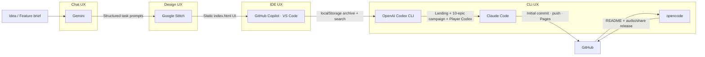

# Chronicles & Curiosities — Multi-Stage AI Workflow

An interactive "Epics" style archival game (`index.html`) built by chaining **multiple AI UX types** — Chat, Design, IDE and CLI — as documented in [`Multi-Stage AI Workflow.md`](./Multi-Stage%20AI%20Workflow.md).

Every stage's output became the next stage's input: **Gemini prompts → Google Stitch UI → Copilot interactivity → Codex game loop → Claude Code / opencode release**.

---

## 1. Problem Selected

Build a polished, single-file interactive web experience that can be split into stages:

1. Prompt & content generation (structured briefs for each feature)
2. UI design (static, presentation-only HTML)
3. Front-end implementation & integration into the codebase
4. Automated verification, documentation, and release

---

## 2. Workflow Across UX Types

| Stage | AI UX Type | Tool | Input | Output |
|-------|-----------|------|-------|--------|
| 1. Prompts | **Chat AI** | Gemini | Feature ideas (archive, epics, tracker, audio/share) | The structured `// Context … // Task` briefs used verbatim by every coding agent |
| 2. Design | **Design AI** | Google Stitch | Those prompts | Static `index.html` (`in.txt` export): Tailwind layout, design tokens, cards, timeline, curator form |
| 3. Interactivity | **IDE AI** | GitHub Copilot (VS Code agent) | Stitch HTML | `initialiseChronicleArchive` — localStorage tales, category filters, live search, curator form submit, HTML escaping, empty state (syntax-checked with `node --check`) |
| 4. Game loop | **CLI AI** | OpenAI Codex CLI | The repo | `initialiseFocusLanding` (cinematic landing + progressive disclosure) and `initialiseEpicCampaign` (10 epics, choices, insight score, reward screen) |
| 5. Release | **CLI AI** | Claude Code | The repo | Git init, `git add`, first commit, push to `origin/main`, relative-path check for GitHub Pages, Pages setup instructions |
| 6. Docs | **CLI AI** | opencode | The repo | This README + [`Multi-Stage AI Workflow.md`](./Multi-Stage%20AI%20Workflow.md) |
| 7. Player systems | **CLI AI** | OpenAI Codex CLI | The repo | Player Codex modal: completion %, truths vs. myths, badges/titles, choice history, Reset Journey (validated: JS syntax, 10-epic count, `git diff --check`) |
| 8. Latest features | **IDE AI → CLI AI** | GitHub Copilot (IntelliJ) → opencode | The repo | "Ambient Audio / Sound FX" toggle (Web Audio API tones) + "Share Your Discovery" card (clipboard summary + canvas PNG export) — Copilot's patch was left uncommitted by a monthly-quota error, then reviewed, bug-fixed, verified and released by opencode |

The **output of each stage becomes the input of the next**: chat produces briefs, the design tool renders them, IDE/CLI agents wire them into code, and the CLI agents package the finished repo.

### Workflow diagram



---

## 3. What Each Agent Actually Did (audit trail)

Work attribution was reconstructed from the local session logs of each agent **and** from the Git history:

| Commit | Message | Co-author trailer | Job |
|--------|---------|-------------------|-----|
| `5e96232` | Initial release: Interactive Epics game | `Co-Authored-By: Claude Sonnet 4.6 <noreply@anthropic.com>` | **Claude Code** — initialised the repo, committed `index.html` + `.gitignore`, pushed `main`, verified relative asset paths for GitHub Pages, and explained the Pages settings |
| `6e7781b` | Add README documenting multi-stage AI workflow and contributors | `Co-authored-by: opencode <opencode@users.noreply.github.com>` | **opencode** — wrote the original README and the workflow write-up |
| `d839d46` | feat: add player progress tracker and achievement codex | `Co-authored-by: Codex AI <codex@openai.com>` | **Codex CLI** — Player Codex modal, achievement badges/titles, choice history, Reset Journey; ran JS syntax + epic-count checks before pushing |
| `ff68dfd` | feat: add ambient audio toggle and shareable discovery cards | `Co-authored-by: GitHub Copilot <copilot@github.com>` + `Co-authored-by: opencode <opencode@users.noreply.github.com>` | **Copilot (IntelliJ)** wrote the feature (Web Audio tones, sound toggle, share modal, canvas card, clipboard copy); **opencode** fixed a canvas string-concatenation bug, delegated click/parchment/success tones, re-verified, committed and pushed |

Session logs used for the audit (local, per tool):

- Claude Code: `~/.claude/projects/C--Users-USER-1-Desktop-Amali/*.jsonl`
- Codex CLI: `~/.codex/sessions/2026/10/18/rollout-*.jsonl`
- GitHub Copilot: `~/.copilot/session-state/*/events.jsonl` (VS Code agent session + IntelliJ session)
- opencode: `~/.local/share/opencode/log/` + this repository's commit trailers
- Gemini & Google Stitch: prompts/designs produced in the browser (no local CLI logs) — their outputs are the `// Context // Task` briefs and the static UI markup now inside `index.html`

---

## 4. Step-by-Step Notes

1. **Prompt stage (Gemini, chat)** — Draft each feature as a self-contained brief: a `// Context` block describing the app state, then a numbered `// Task` list (e.g. 10-epic campaign, Player Codex, Ambient Audio + Share). Tool-agnostic prompts mean any chat model can rewrite them.
2. **Design stage (Google Stitch, chat/design)** — Feed the brief to the design tool and export a static HTML page. Only presentation lives here: layout, Tailwind tokens, cards, timeline, curator form.
3. **Interactivity stage (Copilot, IDE)** — Open the export in the editor and ask for the client-side behaviour: seed `localStorage`, render the list, wire filter tabs, search and form submission. Validate embedded JS with `node --check`.
4. **Game stage (Codex, CLI)** — Hand the same file to a CLI agent to refactor into a game: cinematic landing with progressive disclosure, then 10 epics with choices, feedback, scoring, persistence, then a Player Codex modal with badges and reset.
5. **Release stage (Claude Code, CLI)** — `git add` / commit / push with an AI co-author trailer, check that asset paths are relative so GitHub Pages serves them, and document the Pages settings.
6. **Latest-feature stage (Copilot IDE → opencode CLI)** — The IDE agent implements the feature; if it stops early (quota, network), the CLI agent picks up the working tree, reviews the diff, fixes bugs, re-validates, then commits and pushes. Handoff happens through the shared repository, not through chat export.
7. **Test end-to-end** — Open `index.html` in a browser: land on the hero, unfurl the archive, play the campaign, open the Player Codex, toggle sound, share a discovery.

---

## 5. Feature Map (current `index.html`)

- **Focus / Immersive Reader landing** — single cinematic hook + "Begin the Journey"; archive revealed on click or scroll
- **10-epic campaign** — scenario cards, choice buttons, historical-truth vs. mythic-path feedback, insight score, 10-step progress track, reward screen
- **Archive sections** — curated tale of the day, History vs. Myth timeline with live search & category chips, curator submission form, citation drawer; everything persists in `localStorage`
- **Player Codex modal** — completion %, truths vs. myths, badges/titles, full choice history, Reset Journey
- **Ambient Audio / Sound FX toggle** — opt-in, persisted Web Audio tones for clicks, parchment turns and discovery success (no audio files, no network)
- **Share Your Discovery** — styled summary card, clipboard copy (with `execCommand` fallback), and a 1200×760 PNG rendered on a `<canvas>`

---

## 6. Running the Project

No build step required:

```bash
git clone https://github.com/MUGWANEZAMANZI/cronicles.git
cd cronicles
# open index.html in any browser, or:
npx serve .
```

GitHub Pages: **Settings → Pages → Build and deployment → Source: Deploy from a branch → `main` / root**.

---

## 7. Adaptability (tool-agnostic by design)

- **Prompt stage:** plain `// Context // Task` text — any chat platform can produce or rewrite it.
- **Design stage:** export is a single dependency-light HTML file (Tailwind CDN, Google Fonts), so no vendor lock-in.
- **Coding stages:** every prompt references file paths and behaviours, not proprietary features; each agent ran the same `node --check` style validation on the embedded script.
- Swapping Gemini → ChatGPT, Stitch → v0, Copilot → Cursor, Codex → Claude Code requires **no workflow changes** — and in fact the repo already mixes four agents in one history.

---

## 8. Efficiency

- Content iteration happens in chat (seconds), not by hand-editing HTML.
- Design, interactivity, game logic and documentation were each handled by the agent best suited to that stage.
- Failure containment: when the IDE agent's quota expired mid-task, the working tree survived in Git, and the CLI agent resumed it — no rework, no prompt re-export.
- Git hygiene (co-author trailers, validation, push) was automated instead of manual.

---

## 9. Deliverables Checklist

- [x] Working AI workflow across **Chat, Design, IDE and CLI** UX types
- [x] Workflow diagram (Mermaid, section 2)
- [x] Written documentation with step-by-step notes (this file)
- [x] Per-commit attribution recovered from agent logs (section 3)
- [x] Working end product: `index.html` interactive game

---

## Evaluation Criteria Coverage

| Criteria | Weight | How this project meets it |
|----------|--------|---------------------------|
| Functionality | 40% | End-to-end playable game (landing → 10 epics → codex → audio/share) built by chaining prompts → design → code → release without breaking |
| Adaptability | 20% | Plain prompt briefs + single-file HTML; six different AI tools were swapped in and out mid-project with no workflow changes |
| Documentation | 20% | This README + diagram + the original brief in the repo + commit-level attribution from real session logs |
| Efficiency | 20% | Each stage was delegated to the matching UX type; an interrupted session was resumed by another agent from the shared Git state |

---

## Contributing

Contributions are welcome! Open an issue or PR.

### Contributors

- [@MUGWANEZAMANZI](https://github.com/MUGWANEZAMANZI) — project author, prompt design and orchestration across all stages
- **Gemini** — generated the structured feature briefs used by every coding stage
- **Google Stitch** — produced the static UI design exported into `index.html`
- **GitHub Copilot** — VS Code agent (localStorage archive, filtering, search, curator form) and IntelliJ agent (Ambient Audio toggle + Share Your Discovery card)
- **OpenAI Codex CLI** — Focus landing, 10-epic campaign, Player Codex tracker (`d839d46`)
- **Claude Code** — initial release, GitHub Pages preparation (`5e96232`)
- **opencode (big-pickle)** — workflow documentation (`6e7781b`) and the audio/share verification, fixes and release
