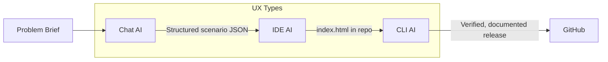

# Chronicles & Curiosities — Multi-Stage AI Workflow

An interactive "Epics" style archival game (`index.html`) built by chaining **three AI UX types** — Chat, IDE, and CLI — as documented in [`Multi-Stage AI Workflow.md`](./Multi-Stage%20AI%20Workflow.md).

---

## 1. Problem Selected

Build a polished, single-file interactive web experience (scenario cards, choices, scoring, archive reveal) that can be split into stages:

1. Concept & structured content generation
2. UI implementation & integration into the codebase
3. Automated verification, polish, and release

---

## 2. Workflow Across UX Types

| Stage | AI UX Type | Tool (example) | Input | Output |
|-------|-----------|----------------|-------|--------|
| 1. Design | **Chat-based AI** | ChatGPT / Gemini Chat | Problem brief | Structured scenario JSON: title, story text, choices, feedback, scores |
| 2. Build | **IDE-based AI** | VS Code + Copilot / Cursor | Scenario JSON + design tokens | `index.html` — Tailwind-styled game UI with the content integrated |
| 3. Ship | **CLI-based AI** | Claude Code / Gemini CLI | Codebase in git | Lint/consistency fixes, accessibility polish, README, commit & push |

The **output of each stage becomes the input of the next**: chat produces structured data, the IDE AI embeds it in code, the CLI AI reviews and packages the finished repo.

### Workflow diagram



---

## 3. Step-by-Step Notes

1. **Chat stage** — Prompt a chat AI with the game concept and a fixed schema (`{ scenario, choices[], feedback, score }`). Iterate on the prompt until the AI returns valid, consistent JSON for all campaign steps. The JSON is pasted into a file (e.g., `scenarios.json` or inline in `index.html`).
2. **IDE stage** — Open the project in an IDE with AI integration. Ask it to build the UI shell (landing screen, campaign track, choice buttons, feedback panel, reward card) and to inject the chat-generated content. Keep the prompt tool-agnostic: "render this JSON schema, no framework, single HTML file."
3. **CLI stage** — From the terminal, the CLI AI runs against the actual repo: checks the HTML for accessibility (`aria-live`, reduced-motion support), consistency of design tokens, and produces documentation (this README). It then stages, commits, and pushes.
4. **Test end-to-end** — Open `index.html` in a browser, play the campaign, confirm scoring and the archive reveal work; verify the repo builds/clones cleanly.

---

## 4. Running the Project

No build step required:

```bash
git clone https://github.com/MUGWANEZAMANZI/cronicles.git
cd cronicles
# open index.html in any browser, or:
npx serve .
```

---

## 5. Adaptability (tool-agnostic by design)

- **Chat stage:** any chat platform — output is plain JSON against a self-defined schema, not tied to one model.
- **IDE stage:** any AI-enabled editor — the UI is a single dependency-light HTML file (Tailwind CDN, Google Fonts), so no vendor lock-in.
- **CLI stage:** any agentic CLI — all prompts reference file paths and schemas, not proprietary features.
- Swapping ChatGPT → Gemini, Copilot → Cursor, or Claude Code → Gemini CLI requires **no workflow changes**.

---

## 6. Efficiency

- Content iteration happens in chat (seconds), not by hand-editing HTML.
- The IDE AI handles repetitive layout/styling while the human focuses on game design.
- The CLI AI automates review, documentation, and git hygiene — the manual effort of writing this README and preparing the release is eliminated.

---

## 7. Deliverables Checklist

- [x] Working AI workflow across **two+ UX types** (Chat → IDE → CLI)
- [x] Workflow diagram (Mermaid, section 2)
- [x] Written documentation with step-by-step notes (this file)
- [x] Working end product: `index.html` interactive game

---

## Evaluation Criteria Coverage

| Criteria | Weight | How this project meets it |
|----------|--------|---------------------------|
| Functionality | 40% | End-to-end playable game; workflow runs from brief → chat JSON → IDE build → CLI release without breaking |
| Adaptability | 20% | Plain JSON schema + single-file HTML; every AI tool is swappable |
| Documentation | 20% | This README + diagram + the original brief in the repo |
| Efficiency | 20% | AI handles content generation, UI scaffolding, review, and release chores |

---

## Contributing

Contributions are welcome! Open an issue or PR.

### Contributors

- [@MUGWANEZAMANZI](https://github.com/MUGWANEZAMANZI) — project author
- **opencode (big-pickle)** — AI contributor via the Chat → IDE → CLI multi-stage workflow (documentation, repo verification, and release automation)
